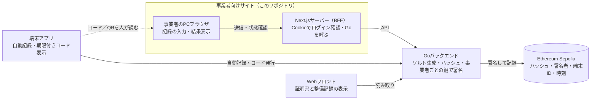

# 全体構成

ブラウザはNext.jsのサーバー側（BFF）とだけ通信し、チェーンへの書き込みはGoだけが行う。



## 通信の決まり

- ブラウザからGoを直接呼ばない。Goを呼ぶのはNext.jsのサーバー側（Route Handler／Server Action）だけ
- `GO_API_BASE_URL` はサーバー側でだけ使い、`NEXT_PUBLIC_` を付けない（付けるとブラウザに漏れる）
- Goから受け取った認証トークンは、partnerドメインのhttpOnly Cookieに入れる
- Webフロントとこのサイトは直接つながない
- アプリとこのサイトの間は、人がコードやQRを読み取るだけで、通信はしない

## BFFにする理由

- ログインのCookieをpartnerドメインの中だけで完結でき、Goのドメイン構成に左右されない
- 認証トークンをブラウザのJavaScriptから読める場所に置かずに済む
- Goのエラー形式をサイト向けのメッセージに変換する場所を1か所にまとめられる

この構成はGo担当との合意前の推奨案。合意したらこの行を消す。

## ディレクトリ構成

```
src/
  proxy.ts                      # 未ログインなら /login へ（Cookieの有無だけ見る）
  config.ts                     # 「案」の数値と環境変数の読み取り
  app/
    login/                      # FR-P01 ログイン画面
    actions/auth.ts             # ログイン・ログアウト（Server Action）
    (protected)/layout.tsx      # トークンをGoに確かめる。ヘッダー
    (protected)/records/new/    # FR-P02・P04・P05 記録の入力から送信結果まで
    api/records/[id]/route.ts   # 送信した記録の状態（BFFのRoute Handler）
  lib/
    go-client/                  # Goを呼ぶ処理（サーバー側専用）。types.ts / http.ts / mock.ts
    schemas/record.ts           # Zodスキーマ（画面とサーバーで共有）
    record-flow.ts              # 送信の状態（FR-P05の状態図）
    time.ts                     # 日本時間 → UTCの変換
    session.ts                  # ログインCookie
e2e/                            # Playwright（受け入れ基準ごと）
```

送信結果は別ページにせず、`/records/new` の中で「入力 → 確認 → 送信中 → 受付済み → チェーン記録済み／失敗」と切り替える。入力内容を残したまま再試行できるようにするため。
