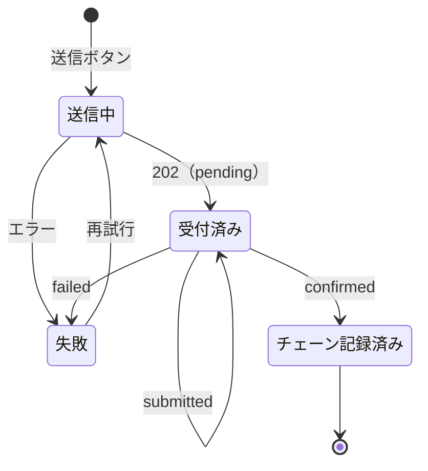

# FR-P05 送信と結果表示

- 優先度：Must（段階1）
- タスク：T-06
- 使うAPI：`POST /maintenance-records`、`GET /maintenance-records/{id}`

## 目的

確認画面から記録を送り、Goでの署名とチェーンへの記録の結果を見せる。チェーンへの記録は数秒〜数十秒かかる（Sepoliaのブロック生成は約12秒）ので、結果は状態の変化として見せる。

## 状態

## 受け入れ基準

1. 画面に「送信中」「受付済み」「チェーン記録済み」「失敗」の4つの状態を表示する。APIの `pending` と `submitted` はどちらも「受付済み」として表示する
2. 受付済みになったら記録IDを表示する
3. チェーン記録済みになったら、トランザクションハッシュ（チェーンへの書き込みの受付番号）と、Sepolia Etherscanのそのトランザクションへのリンクを表示する
4. 受付済みの間は `GET /maintenance-records/{id}` を3秒ごとに呼んで状態を更新する（案）。2分を超えたら問い合わせをやめ、「確認に時間がかかっています」と記録IDを表示する
5. 送信ボタンを二重に押しても記録が2件できない。確認画面を開いた時点でUUIDを1つ作り、`Idempotency-Key` ヘッダーで送る。送信で失敗したとき（Goに届いたか分からないとき）の再試行は同じキーを使う
6. 失敗したら理由と「再試行」ボタンを表示し、入力内容は消さない

## 実装で決めたこと（要確認）

- Goが `failed` を返したあとの再試行は、新しいキーで別の記録として送る。同じキーだとGoが失敗済みの記録を返すだけになるため。Go側の冪等キーの扱いと合わせて確認する
- 送信結果は別ページにせず、入力画面の中で状態を切り替える（`architecture.md`）

## やらないこと

- 送信後の記録の編集・削除（チェーンの記録は消せない。訂正はFR-P07）
- ブラウザを閉じた後の状態通知

## テスト

- E2E：基準1〜6（モックで成功、遅延、失敗、2分超えを再現する）
- 単体：状態の変化（上の図）を管理する処理

## 確認が必要な点

- Etherscanのリンクの形式（`https://sepolia.etherscan.io/tx/<txHash>` を想定。T-06で実際に開けるか確かめる）
- 署名者アドレスを画面に出すか。代理送信の場合、チェーン上の送信元は運営のアドレスになる（`requirements.md` 7章）
