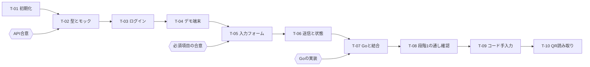

# タスク一覧

T-08（段階1の通し確認）までが発表に必須。T-01〜T-06はモックで実装済み（2026-10-30。APIの形と「案」の数値は未合意のまま。T-01のCIはGitHubに上げてから確認する）。次はGoの実装を待ってT-07。T-09以降は段階1が完成してから着手する。

1タスクは「AIに1回で頼めて、人が30分以内にレビューできる大きさ」を目安にしている。AIに頼むときは次の形にする。

> docs/tasks.md の T-05 を実装して。対応する仕様の受け入れ基準をすべて満たし、テストが通ったら止まって報告して。仕様にないことは実装せずに質問して。

## 依存関係

## タスク

| ID | 内容 | 仕様 | 前提 | 完了条件 | 状態 |
| --- | --- | --- | --- | --- | --- |
| T-01 | リポジトリ初期化（Next.js、TypeScript strict、Lint、Vitest、Playwright、CI）。バージョン固定、`CLAUDE.md` のコマンド欄と確認事項を埋める | `requirements.md` 3章 | なし | `npm run lint`・`test`・`e2e` がCIで通る。`.env.example` がある | 完了（モック） |
| T-02 | APIの型とモック | `api-contract.md` | T-01、API合意 | 全APIがモックで応答し、成功・失敗・遅延を切り替えられる。型がコードから使える | 完了（モック） |
| T-03 | ログインとルート保護（BFF、Cookie） | `specs/FR-P01.md` | T-02 | 受け入れ基準1〜5のテストが通る | 完了（モック） |
| T-04 | デモ端末の表示 | `specs/FR-P02.md` | T-03 | 受け入れ基準1〜3のテストが通る | 完了（モック） |
| T-05 | 入力フォームと確認画面 | `specs/FR-P04.md` | T-04、必須項目の合意 | 受け入れ基準1〜7と日時変換のテストが通る | 完了（モック） |
| T-06 | 送信と状態表示 | `specs/FR-P05.md` | T-05 | 受け入れ基準1〜6のテストが通る | 完了（モック） |
| T-07 | Goの実APIとつなぐ | `api-contract.md` | T-06、Goの実装 | `USE_API_MOCK=false` でSepoliaに1件記録でき、Etherscanで確認できる | 未着手 |
| T-08 | 段階1の通し確認 | `requirements.md` 1章 | T-07 | バッテリー交換の筋書き（下）を最後まで通せる | 未着手 |
| T-09 | コードの手入力 | `specs/FR-P03.md` | T-08 | 受け入れ基準1〜4のテストが通る | 未着手 |
| T-10 | QRの読み取り | `specs/FR-P03.md` | T-09 | 受け入れ基準5を会場と同じPC・カメラで確認できる | 未着手 |

## T-08 の筋書き（バッテリー交換）

人が手で確認する。AIは手順書（`tests/manual/demo.md`）を作るところまで。

1. デモアカウントでログインし、デモ端末にバッテリー交換の記録を1件書く
2. チェーン記録済みになり、Etherscanでトランザクションが見える
3. アプリの自動記録で、バッテリーのサイクル回数がリセットされている
4. Webフロントの証明書詳細に修理店の記録が並び、リセットが交換によるものだと分かる
5. ブラウザ検証が「一致」になる
6. 記録を書き換えると、検証が「不一致」になる

3〜6はアプリとWebフロントの担当分。このサイトの完了条件は1〜2で、3〜6は一緒に確認する。
